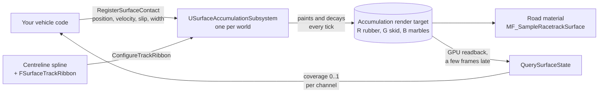

# RacetrackSurface: how to use

RacetrackSurface keeps a persistent record of what cars have done to a racetrack's surface. It stores three
things:

- **rubber buildup**, which forms a racing line where cars drive most
- **skid marks**, from locked wheels
- **marbles**, the rubber debris thrown off-line in corners

You feed it tyre contacts every frame. It paints them into a GPU texture that your road material displays, and
you can read the surface back at any point to change grip yourself.

The plugin does not depend on any vehicle system. It only needs a position, a velocity and a slip value for each
tyre, so it works with Chaos Vehicles, a custom physics model or AI cars on a spline.



## Requirements

- Unreal Engine 5.8. It was built and tested on 5.8.2, Win64, D3D12 SM6. Other platforms and RHIs have not been
  tested.
- A `USplineComponent` running along the centre of the track.
- A road mesh whose UV0 is laid out along the track. This is only needed to display the surface. See
  [step 4](#4-show-it-on-the-road).

## 1. Install

1. Copy the `RacetrackSurface` folder into `<YourProject>/Plugins/`. Keep `Content/` and `Shaders/`, because the
   material function and the decay compute shader live there.
2. Enable **RacetrackSurface** in the Plugins window, or add it to your `.uproject`.
3. Regenerate project files and build.
4. If you call it from C++, add the module to your `Build.cs`:

   ```csharp
   PublicDependencyModuleNames.AddRange(new string[] { "RacetrackSurface" });
   ```

Everything is also exposed to Blueprint under the **Racetrack Surface** category, so a Blueprint-only project can
skip step 4.

## 2. Track space

The surface is not stored in world space. It is stored as a ribbon unrolled along the centreline spline:

```
  left edge    alpha = -1   UV0.V = 0   ──────────────────────────────────────────────
                                         · · · · · · · ·  centreline spline  · · · · ·   alpha = 0
  right edge   alpha = +1   UV0.V = 1   ──────────────────────────────────────────────
                                         0 ─────────── distance along centreline ──► TrackLength
                                         UV0.U = 0                                    UV0.U = 1
```

- **DistanceAlongCentreline** is in centimetres along the spline.
- **LateralOffsetAlpha** runs from -1 to +1 across the track. +1 is the side the spline's right vector points to.
- Anything with an alpha beyond ±1 is off the track. It is not stored, and contacts there are discarded.

You describe the ribbon with an `FSurfaceTrackRibbon`:

| Field | Meaning | Default |
|---|---|---|
| `TrackLength` | Length of the lap in cm. Use the spline length. | 180000 |
| `TrackWidth` | Full width in cm that can be marked. Include any run-off you want marked. | 800 |
| `CentimetresPerTexel` | Resolution. Smaller is sharper and uses more memory. | 3.125 |
| `bClosedLoop` | Whether the end joins back to the start. | true |

**Memory.** The buffer is RGBA32f, which is 16 bytes per texel:

```
bytes ≈ (TrackLength / CentimetresPerTexel) × (TrackWidth / CentimetresPerTexel) × 16
```

A 1.8 km lap at 8 m wide and 3.125 cm per texel comes to about 236 MB. Doubling `CentimetresPerTexel` quarters
that. Long tracks are folded into rows automatically to stay under the 16384 texel texture limit. If a layout
still does not fit, `LogRacetrackSurface` logs an error saying so.

## 3. Configure the track

Do this once per world, at `BeginPlay`, before you register contacts or bind materials.

```cpp
#include "SurfaceAccumulationSubsystem.h"

void AMyTrack::BeginPlay()
{
    Super::BeginPlay();

    USurfaceAccumulationSubsystem* Surface = GetWorld()->GetSubsystem<USurfaceAccumulationSubsystem>();

    FSurfaceTrackRibbon Ribbon;
    Ribbon.TrackLength = Centreline->GetSplineLength();
    Ribbon.TrackWidth = 1200.0;
    Ribbon.CentimetresPerTexel = 3.125;
    Ribbon.bClosedLoop = Centreline->IsClosedLoop();

    Surface->ConfigureTrackRibbon(Centreline, Ribbon);
}
```

The Blueprint equivalent is **Configure Track Ribbon**. There is one ribbon per world, so a second call replaces
the first.

## 4. Feed tyre contacts

Every frame, register each wheel that is touching the ground:

```cpp
Surface->RegisterSurfaceContact(ContactPoint, ContactVelocity, SlipAmount, TyreWidth);
```

| Parameter | Unit | What to pass |
|---|---|---|
| `WorldPosition` | cm | The tyre's contact point. |
| `Velocity` | cm/s | The contact point's world velocity. It is used to paint a continuous stroke over the distance travelled this frame. If you pass zero, the marks come out as dots at speed. |
| `SlipAmount` | 0..1 | How hard the tyre is working. See below. |
| `ContactWidth` | cm | Tyre width. Defaults to 20. |

**SlipAmount decides what gets painted:**

| SlipAmount | Paints |
|---|---|
| `0` to just under `1` | Rubber. More slip lays down more rubber. In corners, slipping tyres also throw marbles towards the outside of the bend, up to 8 m at full slip. |
| exactly `1` | A skid mark. This value means a **locked wheel**. |

Keep rolling slip below 1, for example clamped to 0.99, and send 1 only when the wheel is actually locked. How you
work slip out depends on your vehicle model. The demo project normalises Chaos's slip ratio and slip angle against
the values at which the tyre saturates, and treats a braked wheel that is barely turning as locked.

The C++ call returns `false` when the contact is dropped, which happens when it is off the ribbon or no
centreline has been configured.

**Track-space variant.** If you already know a car's track coordinates, for example AI that follows the spline,
call `RegisterSurfaceContactInTrackSpace` and skip the world-to-spline projection. Pass the centreline to
`ConfigureTrackRibbon` anyway, because marbles are placed using the spline's curvature.

## 5. Show it on the road

The plugin ships `/RacetrackSurface/Materials/MF_SampleRacetrackSurface`. It reads the buffer using the mesh's UV0
and returns coverage from 0 to 1.

```
  TextureObjectParameter "AccumulationTarget"  ──►  MF_SampleRacetrackSurface  ──►  Coverage (RGB)
  default: T_EmptyAccumulation                                                  ──►  Buildup
                                                                                ──►  Skid
                                                                                ──►  Marbles
```

1. In your road material, add a **TextureObjectParameter** named `AccumulationTarget` and set its default to
   `/RacetrackSurface/Materials/T_EmptyAccumulation`.
2. Feed it into `MF_SampleRacetrackSurface`. Then use the outputs however you like, for example to darken base
   colour by `Buildup` and `Skid`, or raise roughness by `Marbles`.
3. Make sure the road mesh's **UV0 follows the ribbon**: U = distance along the centreline ÷ `TrackLength`, and
   V = 0 on the left edge to 1 on the right edge, as in the diagram above. On a long lap, half-precision UVs
   lose too much precision along the track, so for a static mesh tick **Use Full Precision UVs** in its build
   settings.
4. At runtime, after `ConfigureTrackRibbon`, bind the live render target:

   ```cpp
   UMaterialInstanceDynamic* RoadMaterial = RoadMesh->CreateDynamicMaterialInstance(0);
   RoadMaterial->SetTextureParameterValue(TEXT("AccumulationTarget"), Surface->GetOrCreateAccumulationTarget());
   ```

   In Blueprint, use **Get Accumulation Target**. Bind after configuring. If the ribbon is reconfigured to a
   different size, the target is recreated and has to be bound again.

The function also exposes a `SurfaceBlurTexels` scalar parameter, default 1, which softens texel edges. Set it to
0 to see the raw texels.

You do not need to touch `MPC_RacetrackSurface`. The subsystem fills it in.

## 6. Read the surface for grip

The plugin never changes grip itself. You query the surface and decide what it means for your tyre model.

A query is a handle. Acquire one per point you want to track, usually one per wheel, and keep it for the car's
lifetime:

```cpp
void AMyCar::BeginPlay()
{
    Super::BeginPlay();

    USurfaceAccumulationSubsystem* Surface = GetWorld()->GetSubsystem<USurfaceAccumulationSubsystem>();

    for (FSurfaceQueryHandle& Query : WheelQueries)
    {
        Query = Surface->AcquireSurfaceQuery();
    }
}

void AMyCar::EndPlay(const EEndPlayReason::Type EndPlayReason)
{
    USurfaceAccumulationSubsystem* Surface = GetWorld()->GetSubsystem<USurfaceAccumulationSubsystem>();

    for (const FSurfaceQueryHandle& Query : WheelQueries)
    {
        Surface->ReleaseSurfaceQuery(Query);
    }

    Super::EndPlay(EndPlayReason);
}
```

Then, each frame:

```cpp
const FSurfaceStateSample Sample = Surface->QuerySurfaceState(WheelQueries[Wheel], ContactPoint);

const float GripMultiplier = Sample.IsUsable()
    ? 1.0f + RubberGripBonus * Sample.RubberBuildup - MarbleGripPenalty * Sample.Marbles
    : 1.0f;
```

`RubberGripBonus` and `MarbleGripPenalty` are your own tuning values. The plugin only supplies the coverages.

What the sample tells you:

| Field | Meaning |
|---|---|
| `RubberBuildup`, `SkidMark`, `Marbles` | Coverage 0..1, averaged over a 20 cm patch. |
| `Status` | `Valid`, `OutsideRegion` (off the track), or `NotYetResolved` (no answer yet). |
| `SecondsSinceResolved` | How old the answer is. |

Things to know:

- **Answers arrive a few frames late.** They are read back from the GPU without stalling it, and the last
  measurement was 3 engine frames. For the first frames after acquiring a handle the status is
  `NotYetResolved`, so treat that as "no change to grip".
- **One handle tracks one point.** Querying the same handle at two positions in one frame only keeps the last
  one.
- Blueprint has the same flow: **Acquire Surface Query**, **Query Surface State**, **Is Surface State Usable**,
  **Release Surface Query**. **Query Surface Coverage** returns a single channel as a float.

## 7. Decay, saving and resetting

The three channels fade differently:

| Channel | Laid down by | Removed by |
|---|---|---|
| Rubber | Every rolling contact | Decay |
| Skid | Locked wheels | Decay, which runs faster where there is a lot of rubber |
| Marbles | Slipping tyres in corners | Tyres driving over them sweep them up, plus decay |

**Decay is off by default.** Turn it on with `r.RacetrackSurface.DecayRate 1`, which gives a half-life of 15
minutes of game time. To change the half-life from C++, call `SetDecayHalfLifeSeconds`.

To set the rate from code, call `SetDecayRate(Rate)` on the subsystem, or **Set Decay Rate** in Blueprint. That
sets one world's rate, while the console variable sets every world's. Whichever was set last wins, so a rain
system can raise the rate and put it back. `GetDecayRate()` returns the rate in force, and the console variable
can be out of date after a code set.

| Call | What it does |
|---|---|
| `ResetSurface()` | Clears the track back to clean tarmac. |
| `SaveSurfaceState(Path)` | Writes the whole surface to a compressed file. |
| `LoadSurfaceState(Path)` | Loads it back. It refuses a file saved from a different ribbon layout and returns `false`. |

All three are available in Blueprint. Surface state is local to each world and is not replicated.

## 8. Tuning and debugging

Console variables:

| Variable | Default | Effect |
|---|---|---|
| `r.RacetrackSurface.DepositionScale` | 1 | Multiplies how much each contact deposits. Raise it to see a session's worth of rubber in a few laps. |
| `r.RacetrackSurface.DecayRate` | 0 | 0 turns decay off. 1 is the default half-life. |
| `r.RacetrackSurface.MarbleSweepRetention` | 0.5 | Fraction of marbles that survive a tyre passing over them. |
| `r.RacetrackSurface.QueryContactPatchWidth` | 20 | Width in cm that a query averages over. |
| `r.RacetrackSurface.DrawQueryOverlay` | 1 | Enables the debug bars drawn by `RacetrackSurfaceQueryOverlay::DrawSurfaceStateSample`. |

The plugin logs to `LogRacetrackSurface`, including the ribbon size it allocated. Its timings show up in CSV
profiles under the `RacetrackSurface` category.

| Symptom | Likely cause |
|---|---|
| Nothing is painted | `ConfigureTrackRibbon` was not called, contacts are off the ribbon (check `GetContactsDiscardedOutsideRibbon()`), or `SlipAmount` is 0. |
| Marks are dotted, not continuous | `Velocity` is zero or wrong. |
| No skid marks | `SlipAmount` never reaches exactly 1. |
| No marbles | `SlipAmount` is 0 in corners, or no spline was passed to `ConfigureTrackRibbon`. |
| Road shows nothing, or marks in the wrong place | The material was bound before `ConfigureTrackRibbon`, or the mesh's UV0 does not follow the ribbon. |
| Queries never become `Valid` | The handle was released, or the position is off the track. The buffer is also only created by the first painted contact or by binding the target, so until one of those happens there is nothing to read. |
| Error saying the ribbon exceeds the texel limit | Raise `CentimetresPerTexel` or reduce `TrackWidth`. |
